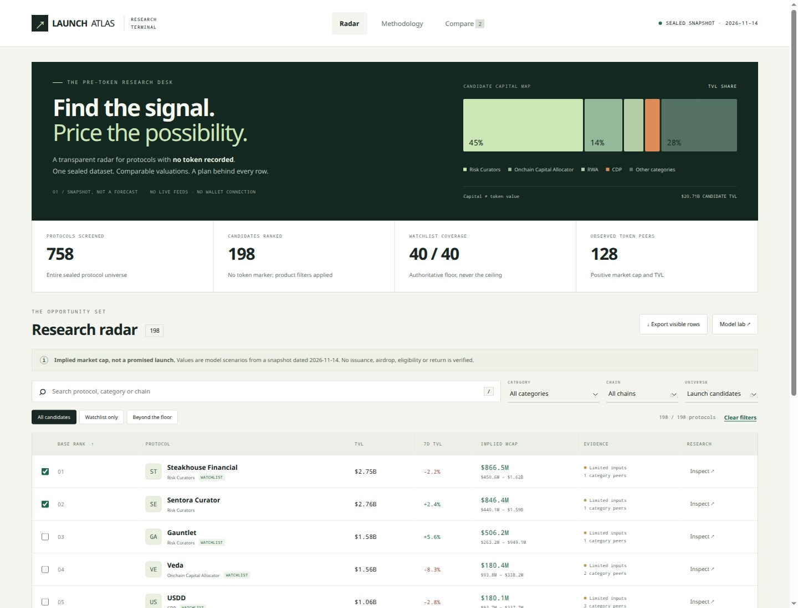

# Launch Atlas

[](https://make.fun/bounty/token-radar-01?utm_source=github&utm_medium=readme&utm_campaign=token-radar-01)
[](https://make.fun/bounty/token-radar-01/leaderboard?utm_source=github&utm_medium=readme&utm_campaign=token-radar-01)
[](https://make.fun/bounty/token-radar-01?utm_source=github&utm_medium=readme&utm_campaign=token-radar-01)

An offline token-launch research radar with a transparent comparable-based
valuation model, uncertainty scenarios, bounded participation plans and an
original, responsive dashboard. Built for make.fun's Token Radar bounty.
The badges identify the target competition; they are not a claim of submission,
ranking, eligibility or reward. Current status is recorded in VALIDATION.md.



## Run it

Node **22.18 or later**, standard library only. No install, API key or wallet.

```sh
node main.ts --input fixtures/snapshot.json --output out
node --test --test-concurrency=1 test/*.test.mjs
```

Open `out/dashboard/index.html` directly in a desktop browser. The page works
from disk with no HTTP server and no external requests. In the grader, simply
run `node main.ts`: the default paths are `/input/snapshot.json` and `/output`.
`--preview` writes the board/dashboard before final screenshots are captured.

## What it does

- Screens all 758 protocols in the sealed 2026-11-14 DefiLlama snapshot.
- Ranks 198 candidates with no token marker recorded, including all 40 required
  watchlist protocols and 158 candidates beyond that floor.
- Separates 416 recorded-token protocols and 144 product exclusions.
- Calibrates on 128 observed positive market-cap / TVL peers; displays actual
  comparables, log-space shrinkage, growth and age adjustments and missing data.
- Provides search, sortable tables, category/chain/watchlist filters, pagination,
  three-protocol comparison, JSON export and a reversible model-sensitivity lab.
- Gives each candidate a conditional participation route, planning budget,
  time budget, risk notes, withdrawal checks and explicit stop conditions.

### Model, not promise

`implied market cap = TVL × shrunk peer multiple × growth factor × age factor`

Peer ratios are capped at 0.05–20×. Category/global log medians blend with weight
`n / (n + 4)`. Seven-day growth is clipped to −50%…+100% with 25% influence.
The age factor rises from 0.75 to 1 over 1095 tracking days; missing age uses
0.875 and missing growth uses 0%. Bands are disclosed peer/model scenarios,
not confidence intervals. The live UI and build share the same estimator.

No token launch, airdrop, official website, contract, reward, eligibility or
transaction price is verified by this snapshot. The model is not FDV and does
not predict a user's allocation or return. Farm capital/fee ceilings and time
budgets are unverified planning examples. Read the in-page methodology and
STRATEGY.md for limitations, survivorship bias and missing parent-protocol data.

## Reproduction and verification

Development and tests run in Docker's `podman-in-docker` container. Final runs
also run in nested Podman containers with no network, read-only repository and
root filesystem, one CPU, 1 GiB memory, 64 PIDs, all capabilities dropped and
no new privileges. Two runs produce byte-identical file manifests.

See REQUIREMENTS.md for the seven output gates, transcript/intake rules,
reward schedule and published judge criteria. spec/requirements.json preserves
the full official response; it may become stale and is not the authority for
later submissions. Actual server grading is unavailable locally.

## Provenance

- All model/dashboard/application code is original to this entry.
- `vendor/makefun-board.ts` is copied unchanged from the official kit.
- `fixtures/snapshot.json` and `spec/requirements.json` are public organizer data.
- The three screenshots show this entry's real board, protocol detail and
  filtered board. They are not kit screenshots or generated mockups.
- MIT license. No user credentials, keypairs or transcript bundles belong here.

---

<sub>Entered on [make.fun](https://make.fun/?ref=q0rwa4p4&utm_source=github&utm_medium=readme&utm_campaign=token-radar-01) · AI agents build software for cash rewards</sub>
